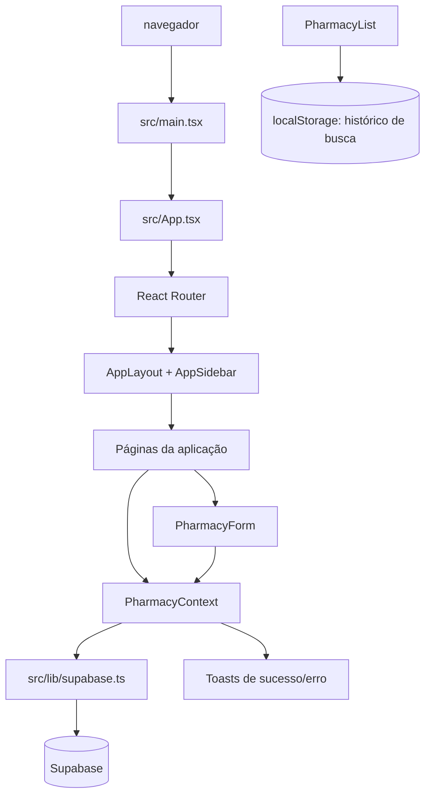

# Farma-Gestão

Sistema web de gestão de farmácias voltado ao acompanhamento de informações cadastrais, responsáveis técnicos e controles regulatórios para vigilância sanitária. A aplicação centraliza o cadastro das farmácias e oferece indicadores para localizar dados incompletos, responsáveis técnicos ausentes e controles mensais ou trimestrais ainda não registrados.

> **Estado atual:** aplicação front-end funcional em React, com persistência no Supabase. O repositório não contém uma API própria, migrações de banco, mecanismo de autenticação ou configuração de deploy.

## Sumário

- [Funcionalidades](#funcionalidades)
- [Tecnologias](#tecnologias)
- [Arquitetura](#arquitetura)
- [Fluxos e regras de negócio](#fluxos-e-regras-de-negócio)
- [Rotas](#rotas)
- [Estrutura do projeto](#estrutura-do-projeto)
- [Pré-requisitos](#pré-requisitos)
- [Instalação](#instalação)
- [Configuração do Supabase](#configuração-do-supabase)
- [Execução e scripts](#execução-e-scripts)
- [Build e publicação](#build-e-publicação)
- [Segurança](#segurança)
- [Manutenção e evolução](#manutenção-e-evolução)
- [Limitações conhecidas](#limitações-conhecidas)

## Funcionalidades

- Dashboard com total de farmácias, pendências técnicas, controles em aberto e campos incompletos.
- Gráficos de cadastros por mês, distribuição de pendências e campos em branco, usando Recharts.
- Histórico de farmácias recentemente atualizadas e modal com o histórico completo.
- Cadastro, consulta, edição e exclusão de farmácias.
- Cadastro opcional de endereço e de múltiplos responsáveis técnicos, identificados por nome e CRF.
- Controle mensal independente para `Receitas A` e `Receitas B2`, com um indicador por mês.
- Controle trimestral com indicadores para os quatro trimestres.
- Busca por nome fantasia, razão social, CNPJ, alvará, e-mail, nome do responsável ou CRF.
- Filtros avançados por campos vazios, período de cadastro, bairro, logradouro e observações.
- Ordenação por nome, CNPJ, data de cadastro ou data de atualização.
- Página de pendências de responsáveis técnicos, com busca, ordenação e acesso à edição.
- Página de prazos e pendências dos controles, com filtros por mês e categoria e visualização por mês ou por categoria.
- Layout responsivo com menu lateral recolhível no desktop e menu móvel.
- Notificações de sucesso e erro com Toast/Sonner.

## Tecnologias

| Tecnologia | Uso no projeto |
| --- | --- |
| React 18 | Construção da interface e composição dos componentes |
| TypeScript | Tipagem dos modelos e componentes, com checagens estritas desativadas na configuração atual |
| Vite 5 | Servidor de desenvolvimento e empacotamento do front-end |
| React Router DOM 6 | Roteamento no cliente com `BrowserRouter` |
| Supabase JS | Acesso ao banco Supabase via cliente JavaScript |
| Tailwind CSS 3 | Estilos utilitários e responsividade |
| shadcn/ui e Radix UI | Componentes de interface acessíveis e primitivas de interação |
| TanStack React Query | Provedor global de query; não há hooks de query usados nas telas atuais |
| Recharts | Gráficos do dashboard e da tela de prazos |
| date-fns | Formatação e cálculo de datas em português brasileiro |
| React Hook Form, Zod e resolvers | Dependências instaladas, sem uso identificado nos fluxos atuais do formulário |
| Lucide React | Ícones |

As dependências exatas estão em [`package.json`](./package.json), e as versões resolvidas estão em [`package-lock.json`](./package-lock.json). O projeto também possui um `bun.lockb`, mas os scripts documentados usam npm.

## Arquitetura

A aplicação é uma SPA (Single-Page Application). O ponto de entrada em [`src/main.tsx`](./src/main.tsx) monta [`src/App.tsx`](./src/App.tsx), que registra os provedores globais, o roteador e as páginas. Não existe camada de servidor ou API intermediária neste repositório.



### Camadas principais

- **Inicialização e composição:** `src/main.tsx` e `src/App.tsx` montam `QueryClientProvider`, `TooltipProvider`, `PharmacyProvider`, notificações e `BrowserRouter`.
- **Apresentação:** `src/pages` contém as telas de negócio; `src/components/layout` contém o shell da aplicação; `src/components/ui` contém componentes reutilizáveis baseados em Radix/shadcn.
- **Estado de negócio:** [`src/context/PharmacyContext.tsx`](./src/context/PharmacyContext.tsx) mantém a lista carregada, estado de carregamento, filtro textual e operações de persistência.
- **Modelo:** [`src/types/pharmacy.types.ts`](./src/types/pharmacy.types.ts) define `Pharmacy`, `Address`, `TechnicalSupervisor`, `MonthlyControl` e `QuarterlyControl`.
- **Persistência:** [`src/lib/supabase.ts`](./src/lib/supabase.ts) cria o cliente Supabase. As telas consultam o contexto, e o contexto faz as operações diretamente nas tabelas relacionadas.
- **Estilo:** [`src/index.css`](./src/index.css), [`src/App.css`](./src/App.css) e [`tailwind.config.ts`](./tailwind.config.ts).

## Fluxos e regras de negócio

### Carregamento e consulta

Ao montar o `PharmacyProvider`, `fetchPharmacies()` busca todas as farmácias e suas relações em uma única consulta relacional. Os nomes de colunas do banco em `snake_case` são transformados para os nomes usados pelo front-end em `camelCase`, por exemplo, `razao_social` para `razaoSocial` e `data_cadastro` para `dataCadastro`.

Os controles relacionados são tratados como um único registro por farmácia no front-end: a primeira linha encontrada em cada tabela de controle é usada. Quando não há registro, a tela trabalha com um objeto vazio e o formulário apresenta os campos desmarcados.

### Cadastro

O formulário em [`src/components/PharmacyForm.tsx`](./src/components/PharmacyForm.tsx) exige HTML5 apenas para CNPJ, razão social, nome fantasia e o primeiro responsável técnico. Telefone, e-mail, alvará, endereço e observações são opcionais; o campo de e-mail usa `type="email"`. Não há validação de formato de CNPJ, CEP ou CRF no código.

Ao cadastrar uma farmácia, o contexto executa, nesta ordem:

1. Faz `upsert` dos responsáveis técnicos em `technical_supervisors`.
2. Insere os dados principais em `pharmacies`.
3. Insere os vínculos em `pharmacy_technical_supervisors`.
4. Insere `addresses` somente se algum campo do endereço estiver preenchido.
5. Insere os registros de `monthly_controls_a`, `monthly_controls_b2` e `quarterly_controls`.
6. Recarrega a lista e exibe uma notificação de sucesso.

Os checkboxes dos controles gravam o valor literal `realizado` quando marcados e uma string vazia quando desmarcados.

### Edição

`EditPharmacy` carrega a farmácia por ID e reutiliza `PharmacyForm`. A atualização altera os campos principais e define `ultima_atualizacao` com `new Date().toISOString()`. Os vínculos de responsáveis são removidos e recriados; o endereço é inserido, atualizado ou excluído conforme o formulário; e cada tabela de controle é atualizada ou criada caso ainda não exista.

### Exclusão

A exclusão parte da lista ou dos detalhes e exige confirmação visual. O código remove a linha de `pharmacies` e depende das regras de relacionamento configuradas no Supabase para tratar os dados associados. O repositório não contém a definição de chaves estrangeiras nem confirma se o banco está configurado com exclusão em cascata.

### Pendências e prazos

- Uma farmácia é considerada sem responsável técnico quando não possui responsáveis ou quando qualquer responsável tem nome ou CRF vazio.
- Um controle está pendente quando seu valor é vazio ou contém apenas espaços.
- `Receitas A` e `Receitas B2` são avaliadas mês a mês, de janeiro a dezembro.
- Cada trimestre pendente é exibido nos três meses que o compõem: 1º trimestre em janeiro-março, 2º em abril-junho, 3º em julho-setembro e 4º em outubro-dezembro.
- A tela de prazos organiza os resultados pelo mês atual e pelos demais meses, podendo alternar entre mais recente e mais antigo.
- O dashboard também contabiliza farmácias sem telefone, e-mail, alvará ou endereço. Endereço é considerado ausente quando não existe ou quando logradouro, bairro, cidade e estado estão todos vazios.

### Busca e histórico local

A lista faz filtragem no cliente. O histórico armazena até cinco termos no `localStorage` sob a chave `pharmacySearchHistory`; ele não é dado de negócio nem é enviado ao Supabase.

## Rotas

| Rota | Tela | Responsabilidade |
| --- | --- | --- |
| `/` | `Dashboard` | Indicadores, gráficos, histórico e alertas |
| `/farmacias` | `PharmacyList` | Lista, busca, filtros, ordenação e exclusão |
| `/farmacias/nova` | `AddPharmacy` | Cadastro de uma nova farmácia |
| `/farmacias/:id` | `PharmacyDetail` | Detalhamento cadastral e dos controles |
| `/farmacias/:id/editar` | `EditPharmacy` | Edição do cadastro e dos controles |
| `/pendencias` | `PendingIssues` | Farmácias sem responsável técnico |
| `/prazos` | `Deadlines` | Controles mensais e trimestrais pendentes |
| demais rotas | `NotFound` | Página 404 |

`src/pages/Index.tsx` existe como componente legado/fallback, mas não é associado a nenhuma rota em `App.tsx`.

## Estrutura do projeto

```text
.
├── public/                  # favicon, robots.txt e placeholder
├── src/
│   ├── components/
│   │   ├── layout/          # AppLayout e AppSidebar
│   │   ├── ui/              # componentes shadcn/Radix reutilizáveis
│   │   └── PharmacyForm.tsx # formulário de cadastro e edição
│   ├── context/
│   │   └── PharmacyContext.tsx
│   ├── hooks/               # use-mobile e use-toast
│   ├── lib/
│   │   ├── supabase.ts      # cliente Supabase
│   │   └── utils.ts         # utilitários de classes
│   ├── pages/               # telas e rotas
│   ├── types/               # modelos TypeScript
│   ├── App.tsx
│   ├── App.css
│   ├── index.css
│   └── main.tsx
├── index.html
├── package.json
├── package-lock.json
├── vite.config.ts
├── tailwind.config.ts
├── components.json
└── eslint.config.js
```

## Pré-requisitos

- Node.js instalado e disponível no `PATH`.
- npm, distribuído com o Node.js, para instalar dependências e executar os scripts.
- Projeto Supabase acessível e com as tabelas e relacionamentos esperados pela aplicação.

O `package.json` não fixa uma versão mínima do Node.js. Recomenda-se validar a versão LTS adotada pelo ambiente antes de atualizar dependências.

## Instalação

```bash
cd farma-gestao-intuitiva
npm install
```

O repositório inclui `package-lock.json`; em ambientes automatizados, prefira `npm ci` para instalar exatamente as versões registradas no lockfile.

## Configuração do Supabase

### Tabelas utilizadas

O código consulta e grava as seguintes tabelas:

| Tabela | Papel |
| --- | --- |
| `pharmacies` | Dados principais: CNPJ, razão social, nome fantasia, telefone, alvará, e-mail, observações e datas |
| `technical_supervisors` | Nome e CRF dos responsáveis técnicos |
| `pharmacy_technical_supervisors` | Tabela de associação entre farmácias e responsáveis |
| `addresses` | Endereço opcional relacionado à farmácia |
| `monthly_controls_a` | Controle mensal de `Receitas A` |
| `monthly_controls_b2` | Controle mensal de `Receitas B2` |
| `quarterly_controls` | Controle dos quatro trimestres |

As relações esperadas pelo `select` relacional são `pharmacy_technical_supervisors` com `technical_supervisor`, além de relações de endereço e controles ligadas por `pharmacy_id`. Os nomes das constraints, tipos, índices, políticas RLS e regras de cascata não estão versionados neste repositório e precisam ser confirmados no projeto Supabase.

### Credenciais

Atualmente, [`src/lib/supabase.ts`](./src/lib/supabase.ts) contém a URL do projeto e uma chave pública diretamente no código. Não há leitura de `import.meta.env`, arquivo `.env.example` ou variáveis de ambiente implementadas.

Para um ambiente de desenvolvimento ou produção, a configuração deve ser revisada antes do deploy para usar variáveis públicas do Vite, por exemplo:

```env
VITE_SUPABASE_URL=https://seu-projeto.supabase.co
VITE_SUPABASE_ANON_KEY=sua-chave-anon-publica
```

O exemplo acima é fictício e não é consumido pela implementação atual. Qualquer alteração para adotá-lo deve incluir a leitura dessas variáveis em `src/lib/supabase.ts` e a configuração delas no ambiente de build. A chave `service_role` ou qualquer segredo administrativo nunca deve ser exposta ao navegador.

## Execução e scripts

```bash
# Servidor de desenvolvimento em http://localhost:8080
npm run dev

# Build de produção
npm run build

# Build usando o modo development do Vite
npm run build:dev

# Verificar o build localmente
npm run preview

# Executar o ESLint
npm run lint
```

O host padrão do Vite está configurado como `::` e a porta como `8080` em [`vite.config.ts`](./vite.config.ts). O endereço efetivo pode variar conforme o ambiente e a rede local.

## Build e publicação

`npm run build` gera os arquivos estáticos no diretório `dist/`, que é ignorado pelo Git. O repositório não possui workflow de CI/CD, Dockerfile, configuração de hospedagem ou comando de publicação.

Para publicar a SPA, o servidor escolhido deve:

1. Servir o conteúdo de `dist/`.
2. Disponibilizar as credenciais públicas do Supabase no momento do build, após a implementação de variáveis de ambiente descrita acima.
3. Redirecionar rotas desconhecidas para `index.html`, pois o roteamento usa `BrowserRouter`.
4. Permitir as chamadas do navegador ao domínio Supabase e configurar as políticas de acesso correspondentes.

O procedimento específico de deploy precisa ser definido de acordo com o provedor escolhido.

## Segurança

- O front-end não implementa autenticação, login, sessão, perfis ou autorização por papel. Todas as rotas são acessíveis no cliente.
- A autorização efetiva das operações depende da configuração do Supabase, especialmente das políticas de Row Level Security (RLS). Como as políticas não estão no repositório, seu estado deve ser auditado antes de uso com dados reais.
- A URL e a chave pública atualmente presentes no código não devem ser copiadas para novos arquivos ou documentadas com seus valores. A chave pública não substitui RLS e não deve ser tratada como segredo administrativo.
- Credenciais, tokens e chaves privadas devem ficar em variáveis de ambiente do provedor, nunca no Git ou no bundle do navegador.
- Dados como CNPJ, contatos, endereço e CRF podem ser informações sensíveis no contexto operacional. Restrinja o acesso ao projeto Supabase e mantenha backups e políticas de retenção conforme a necessidade do órgão responsável.
- Erros de persistência são registrados no console do navegador. Em produção, evite expor detalhes de infraestrutura ao usuário e avalie uma estratégia de observabilidade segura.
- A exclusão é permanente do ponto de vista da interface e não há fluxo de recuperação ou auditoria de alterações implementado.

## Manutenção e evolução

### Convenções práticas

- Componentes de tela ficam em `src/pages`; comportamento compartilhado de farmácias deve permanecer no `PharmacyContext` ou ser extraído para um módulo reutilizável quando crescer.
- Novas tabelas ou mudanças de relacionamento devem ser acompanhadas de migração versionada; atualmente nenhuma migração está presente.
- Ao alterar o modelo persistido, atualize `src/types/pharmacy.types.ts`, o mapeamento de leitura/escrita do contexto e o formulário/detalhe correspondentes.
- Preserve o alias `@/*`, configurado em `tsconfig.app.json` e `vite.config.ts`, ao adicionar imports.
- Execute `npm run lint` e `npm run build` antes de abrir uma alteração.

### Áreas prioritárias para evolução

- Externalizar a configuração do Supabase e remover valores hardcoded do código-fonte.
- Implementar autenticação e autorização, caso o sistema seja disponibilizado a mais de um perfil de usuário.
- Adicionar migrações SQL, constraints, índices, RLS e documentação do esquema ao repositório.
- Tornar o cadastro/edição transacional ou implementar compensação para evitar registros parciais quando uma das várias operações falhar.
- Adicionar testes automatizados para regras de pendências, filtros e operações CRUD.
- Corrigir o fluxo de submissão do formulário para aguardar as operações assíncronas antes de navegar e tratar falhas de forma determinística.
- Avaliar paginação e filtragem no banco para conjuntos grandes de farmácias; hoje os dados são carregados e filtrados no navegador.
- Definir um processo de deploy, versionamento e monitoramento.

## Limitações conhecidas

- O banco é uma dependência externa e seu esquema completo não pode ser reproduzido apenas a partir deste repositório.
- Não há autenticação nem controle de acesso no front-end.
- Não há uso de Firebase, Firestore, Storage de arquivos, geração de PDF/documentos ou integrações externas adicionais identificadas no código.
- Os controles são apenas marcadores de status (`realizado` ou vazio); não existe registro de data, usuário, observação ou histórico por lançamento.
- A lógica de prazos calcula pendências para todos os meses e projeta cada trimestre em três meses, mas não aplica validação baseada em ano de referência aos campos de controle.
- A aplicação assume que cada farmácia possui no máximo um registro de endereço e um registro em cada tabela de controle, embora essa garantia não esteja definida nos arquivos do projeto.
- O `upsert` de responsáveis técnicos depende da configuração de unicidade correspondente no Supabase; a constraint necessária não está documentada no repositório.
- O formulário não valida semanticamente CNPJ, CEP, UF, CRF ou unicidade de farmácia.
- Não há testes automatizados nem pipeline de integração contínua configurados.

## Referências de implementação

- Entrada e rotas: [`src/main.tsx`](./src/main.tsx), [`src/App.tsx`](./src/App.tsx)
- Estado e persistência: [`src/context/PharmacyContext.tsx`](./src/context/PharmacyContext.tsx), [`src/lib/supabase.ts`](./src/lib/supabase.ts)
- Modelos: [`src/types/pharmacy.types.ts`](./src/types/pharmacy.types.ts)
- Formulário: [`src/components/PharmacyForm.tsx`](./src/components/PharmacyForm.tsx)
- Indicadores: [`src/pages/Dashboard.tsx`](./src/pages/Dashboard.tsx)
- Busca e cadastro: [`src/pages/PharmacyList.tsx`](./src/pages/PharmacyList.tsx), [`src/pages/AddPharmacy.tsx`](./src/pages/AddPharmacy.tsx), [`src/pages/EditPharmacy.tsx`](./src/pages/EditPharmacy.tsx)
- Pendências: [`src/pages/PendingIssues.tsx`](./src/pages/PendingIssues.tsx), [`src/pages/Deadlines.tsx`](./src/pages/Deadlines.tsx)
